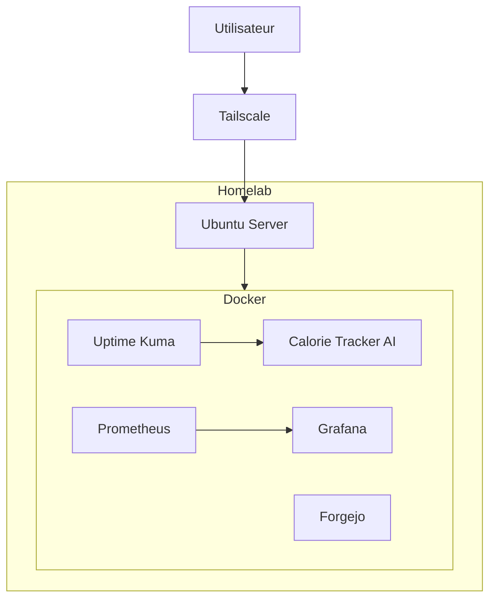

# Architecture cible

## Vision

L'objectif de ce homelab est de disposer d'un environnement personnel permettant :

- l'hébergement d'applications personnelles ;
- l'apprentissage des technologies DevOps ;
- l'expérimentation de Docker, Kubernetes et GitOps ;
- la supervision de services comme en environnement professionnel.

## Architecture cible



## Services

### Calorie Tracker AI

Application personnelle développée en Next.js.

Fonctionnalités :

- suivi calorique ;
- analyse IA des repas ;
- statistiques ;
- PWA.

### Uptime Kuma

Surveillance de la disponibilité :

- Calorie Tracker AI ;
- Forgejo ;
- services futurs.

### Prometheus

Collecte des métriques système et applicatives.

### Grafana

Visualisation des métriques :

- CPU ;
- mémoire ;
- stockage ;
- disponibilité.

### Forgejo

Forge Git personnel permettant :

- l'hébergement de dépôts ;
- les tests CI/CD ;
- l'apprentissage GitOps.

## Évolutions prévues

### Court terme

- Déploiement du Calorie Tracker AI
- Monitoring Grafana + Prometheus
- Accès distant via Tailscale

### Moyen terme

- Reverse proxy Traefik
- HTTPS Let's Encrypt
- Sauvegardes automatisées

### Long terme

- Migration vers Proxmox
- Cluster k3s
- ArgoCD
- GitOps
```